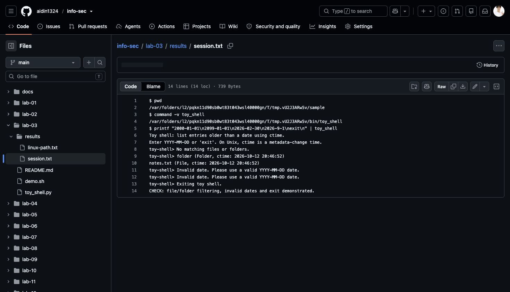

# Lab 3: toy shell

Adapted from the [assignment's Python example](https://docs.google.com/document/d/1Ubfi15uduKb4DjIYszmGdIclY_7THNAHx6gQnqCo5iI/edit).

## Run

From the repository root:

```bash
python3 lab-03/toy_shell.py
```

Enter `YYYY-MM-DD` or `exit`. The program lists files and folders in the current directory whose `ctime` is earlier than local midnight on that date. On Unix, `ctime` records metadata changes, not file creation.

To run as `toy_shell` from another directory:

```bash
shell_file="$PWD/lab-03/toy_shell.py"
bin_dir=$(mktemp -d)
ln -s "$shell_file" "$bin_dir/toy_shell"
export PATH="$bin_dir:$PATH"
cd /tmp
toy_shell
```

The assignment's installation in `/usr/local/bin/toy_shell` was also [checked inside Linux Docker](results/linux-path.txt).

## Results

| Input | Result |
|---|---|
| `2000-01-01` | No newly created sample entries match. |
| `2099-01-01` | Both sample file and folder appear. |
| `2026-02-30`, `2026-9-1` | Invalid date or format rejected. |
| `exit`, Ctrl+D | Clean exit. |
| Ctrl+C | Continues and prints how to exit. |

[Run log, 12 October 2026](results/session.txt).

Run the full demonstration with `bash lab-03/demo.sh`.

## Screenshot

Chrome screenshot of the execution log on GitHub.


