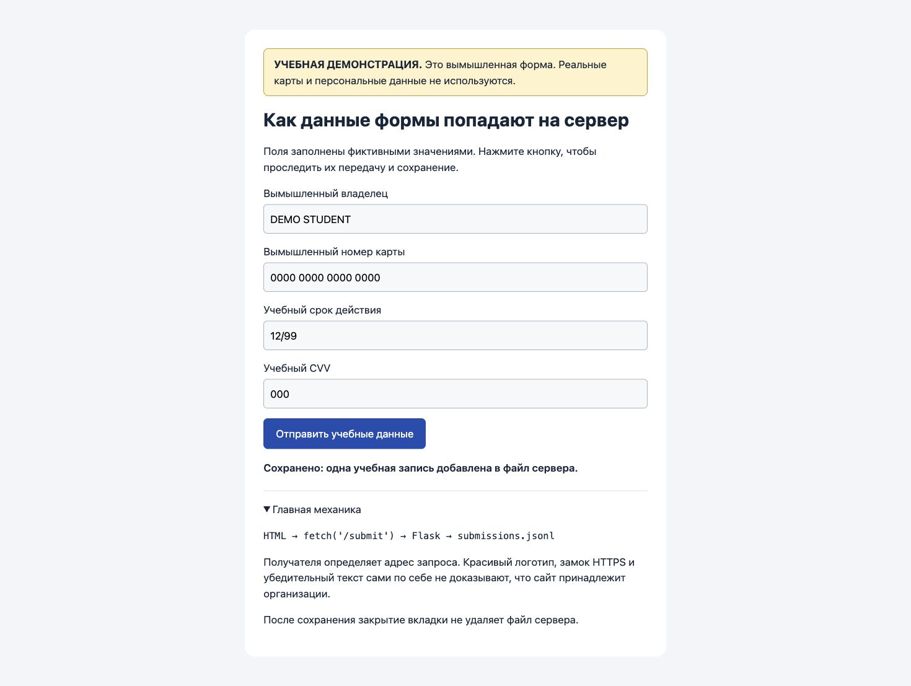

# Lab 4: local phishing-awareness simulation

Implements the local payment-form assignment in [Labs 4–6](https://docs.google.com/document/d/1iLU-oof3YflO--nj00r0LgKvT8UiGYt2/edit). The [separate Lab 4 document](https://docs.google.com/document/d/1cGUkFKaxVDsjgh9YeU5-b-tgZ3gNHti0/edit) also requests email delivery and public hosting. Those parts are not implemented. The supplement makes email optional and specifies local testing.

## Run

From the repository root:

```bash
python3 -m venv .venv
.venv/bin/python -m pip install -r lab-04/requirements.txt
.venv/bin/python lab-04/app.py
```

Open <http://127.0.0.1:8040/>, submit the fixed fictional data, then inspect:

```bash
cat lab-04/runtime/submissions.jsonl
```

Stop the server with Ctrl+C. No real card data is accepted.

## Mechanism and defenses

- HTML → JavaScript `fetch` → `POST /submit` → Flask validation → one JSON line appended to the server's file.
- `201` means saved. `400` rejects altered values. Validation is server-side because browser fields can be changed. Closing the tab or restarting the server leaves saved rows intact.
- Detect phishing by checking the destination domain and unexpected requests for sensitive data. HTTPS alone does not establish who owns a site.
- Defenses: email gateways and URL/content filtering. SPF, DKIM and DMARC against sender-domain spoofing. Phishing-resistant MFA for account access. Awareness training and a clear reporting channel. MFA does not prevent a person from disclosing card details.

## Evidence

[HTTP results](results/http.txt) · [browser check](results/browser.txt) · [fictional saved rows](results/submissions.jsonl) · [email preview, not sent](results/training-email.eml).


