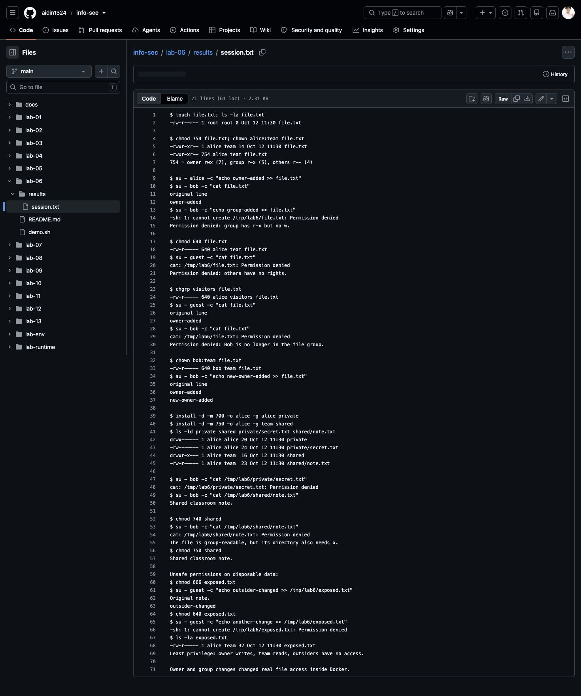

# Lab 6: Linux permissions

Sources: [Lab 6](https://docs.google.com/document/d/1sgkWFDTC5tEzzbnh5R0RYNuQmiOth6OMrH6gMbx9bO8/edit) and the additional assignments in [Labs 4–6](https://docs.google.com/document/d/1iLU-oof3YflO--nj00r0LgKvT8UiGYt2/edit).

## Run

From the repository root, with Docker running:

```bash
docker build -t info-sec-course -f lab-env/Dockerfile lab-env
docker run --rm --network none --mount "type=bind,src=$PWD/lab-06/demo.sh,dst=/demo.sh,readonly" info-sec-course bash /demo.sh
```

## Results

| Exercise | Observed result |
|---|---|
| `touch`, `ls -la`, `chmod 754` | Owner `rwx`, group `r-x`, others `r--`. Bob cannot write. |
| `chmod 640`, `chgrp`, `chown` | Changing the group transfers read access. Making Bob the owner grants him write access. |
| Several files and directories | Private directory `700` / file `600`. Shared directory `750` / file `640`. |
| Directory traversal | Bob cannot read a group-readable file while its directory lacks group `x`. Restoring `x` restores access. |
| Unsafe permissions | With `666`, an outsider modifies a file. With `640`, the same write is denied. |

[Recorded execution](results/session.txt). Commands run as three ordinary users inside a disposable container. `root` is only used for setup.

`r=4`, `w=2`, `x=1`. Directory `x` allows traversal. File `x` allows execution. Deleting a file normally depends on its parent directory's permissions, not the file's write bit. Audit both files and their parent directories. Grant only the access each user needs.

## Screenshot

Unedited capture from Chrome on the laptop. The page displays the actual execution log on GitHub.


