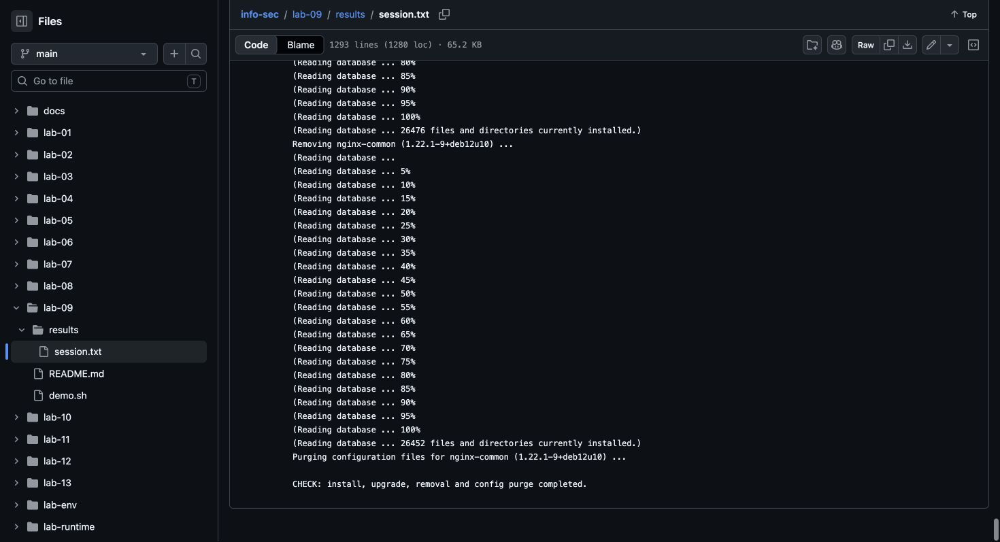

# Lab 9: Package management

[Assignment](https://docs.google.com/document/d/1rFiDMgbFkb6UjhrzTBBP1QnEyAXO8zd-/edit).

## Run

From the repository root, with Docker running:

```bash
docker build -t info-sec-course -f lab-env/Dockerfile lab-env
docker run --rm --mount "type=bind,src=$PWD/lab-09,dst=/lab,readonly" info-sec-course bash /lab/demo.sh
```

## Results

Installed and inspected NGINX, displayed dependencies, upgraded packages, removed NGINX and purged its configuration. `apt update` updates the index. `upgrade` updates installed packages. `remove` keeps configuration, while `purge` removes it.

[Execution log](results/session.txt).

## Screenshot

Chrome screenshot of the execution log on GitHub.


