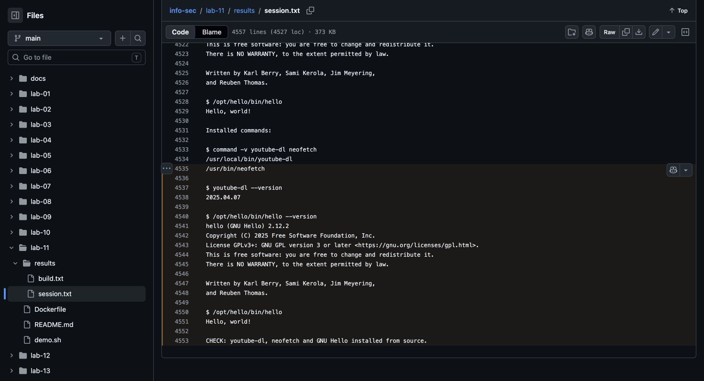

# Lab 11: Installation from source

[Assignment](https://docs.google.com/document/d/1yijCePACQg2ZdgVb51BU4aZUHl_DMwCz/edit).

## Run

From the repository root, with Docker running:

```bash
docker build -t info-sec-course -f lab-env/Dockerfile lab-env
docker build -t info-sec-source -f lab-11/Dockerfile lab-11
docker run --rm --mount "type=bind,src=$PWD/lab-11,dst=/lab,readonly" info-sec-source bash /lab/demo.sh
```

## Results

Installed the two course examples from Git: `youtube-dl` through `setup.py`, and `neofetch` through `make install`. Independently built GNU Hello: download → SHA-256 check → extract → configure → make → install. The script fixes Git revisions and the archive checksum. It does not download videos.

[Execution log](results/session.txt).

## Screenshot

Chrome screenshot of the execution log on GitHub.


